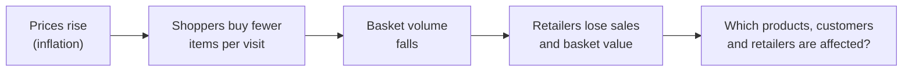
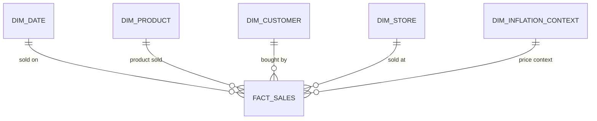

<div align="center">

<h1>🧺 The Broken Basket</h1>

**Investigates why shoppers may be buying fewer items per visit under inflation, finds the products, customers and retailers losing basket volume, and shows how retailers could protect customer spend.**


**[📊 View my portfolio](ADD-YOUR-PORTFOLIO-LINK-HERE)** · **[🧱 How it was built](#4-methodology)**

</div>

---

## 1. Title

**Retail Basket Analysis: a Power BI dashboard (descriptive and diagnostic analysis) of basket contraction in Nigerian supermarkets**

| | |
|---|---|
| **Type of analysis** | Descriptive (what happened) and diagnostic (where and for whom it happened): basket size, product penetration, customer segments and retailer performance |
| **Industry** | Retail and FMCG, supermarkets in Southwest Nigeria (Lagos, Ogun and Oyo) |
| **Tools** | MySQL, SQL, Power BI, DAX |
| **Data** | Synthetic transaction data (portfolio project) |

---

## 2. Executive summary

- **Business problem.** When prices rise, shoppers may quietly put fewer items in the basket. Retailers need to know *which* products, customers and stores are losing ground before they lose revenue.
- **Solution.** I built a star-schema MySQL database and a five-page Power BI report that compare an early baseline with a recent baseline, and break the change down by product, income group and retailer.
- **Impact.**

| Finding | Result |
|---|---|
| Total items sold, early vs recent baseline | **46,000 → 43,000 (−6.5%)** |
| Products that lost basket penetration | **23 of 30** |
| Products anchoring the baskets | **only 7 core products** |
| Basket size and value by income group | **High > Medium > Low** |

- **Next steps.** Test the recommended offers in a controlled trial, repeat the analysis on real transactions, and measure basket size per ticket by price band to see whether price changes drive the drop. [Details in section 7.](#7-next-steps)

### ⭐ What makes this project stand out
1. **It goes from raw transactions to a decision.** A modelled database, a dashboard, findings and recommendations are all here.
2. **It is built on a proper star schema.** One sales fact table and clean dimensions make every question easy to answer.
3. **It is honest about what the data can prove.** It shows patterns, not proof that inflation caused them.
4. **The reasoning is visible.** Each finding comes with the evidence behind it and an action.
5. **It covers several angles at once.** Products, customer segments, retailers and basket exceptions share one report.

---

## 3. Business problem



**How the business works.** A supermarket earns money from the number of items and the value in each basket. Customers across income groups shop at different retailers and buy different product categories. If the basket shrinks even slightly, revenue falls across thousands of tickets.

**The questions.**
1. Are customers buying fewer items per visit?
2. Which products or categories are losing basket penetration?
3. What could retailers do to protect customer spend?

**Why I chose to solve it.**
<!-- Edit this section in your own words. -->
- Inflation is felt every day at the checkout, so basket behaviour is one of the clearest places to see its effect.
- Retailers can act on the answers quickly: with offers, bundles and shelf decisions.
- It let me show a full analytics workflow, from a modelled database to a decision-ready dashboard.

---

## 4. Methodology

**Approach:** star-schema modelling, SQL analysis and an interactive Power BI report, comparing an early baseline with a recent baseline.

| Step | What I did |
|---|---|
| 1. Frame | Defined the three business questions and the measures (items per ticket, basket value, product penetration) |
| 2. Model | Designed a **star schema** in MySQL with one sales fact table and descriptive dimensions |
| 3. Query | Wrote SQL to clean, load and analyse the data |
| 4. Visualise | Built a five-page Power BI report with DAX measures |
| 5. Explain | Wrote findings and recommendations, with the limits stated |



**Report pages:** Overview · Customer Analytics · Product Analytics · Retailer Opportunity · Basket Exceptions

**About the data.** All transaction data is **synthetic**. It was created for portfolio analysis and does not represent real customers, stores or sales.
<!-- Verify before publishing: 30,000 tickets, 68,703 sales lines, 30 products, 12 branches across Lagos, Ogun and Oyo, 4 retail brands. -->
The dataset covers 30 products and 12 supermarket branches across Lagos, Ogun and Oyo, split across four retail brands.

### Repository guide
```
sql/                    Database schema, data setup and analysis queries
Screen_records/         Dashboard recordings and previews
The Broken Basket.pbix  Power BI report (open in Power BI Desktop)
data_dictionary.md      Column definitions
```

### How to use
1. Run the SQL files in `sql/` in order, after checking that the database and table names match your MySQL setup.
2. Open `The Broken Basket.pbix` in Power BI Desktop.
3. If your local database connection differs, update the data source settings.

---

## 5. Skills

| Area | What I did in this project |
|---|---|
| **MySQL and SQL** | Schema design, data loading, and analysis queries for basket size and product performance |
| **Data modelling** | Star schema with a sales fact table and date, product, customer, store and inflation-context dimensions |
| **Power BI and DAX** | Interactive five-page report with measures for retail and basket performance |
| **Analysis** | Baseline comparison, segmentation by income group and retailer, product penetration analysis |
| **Communication** | Findings and recommendations explained in plain language |

---

## 6. Results and business recommendations

### Key findings

1. **Total items sold fell 6.5%, from 46,000 to 43,000.** The early baseline was 46,000 items and the recent baseline is 43,000, a sign of weaker cross-selling.
2. **A few products hold up the baskets.** Only 7 core products anchor customer baskets, while 23 products lost basket penetration. The fall in volume follows that pattern.
3. **Higher-income customers buy more.** The high-income segment has the largest basket size and value. Medium- and low-income segments show progressively fewer multi-item baskets.
4. **Retailers differ.** Retailer A has the highest revenue density, while Retailer B falls below baseline expectations and shows weaker basket-size consistency across locations.

### Business recommendations

| # | Because… | I recommend… | I'd measure it by… |
|---|---|---|---|
| 1 | basket volume fell by about 3,000 items (46,000 to 43,000) | a "buy more, save 10%" prompt at checkout, to encourage cross-selling | items per ticket |
| 2 | low- and medium-income baskets are smaller, while high-income baskets are strongest | budget bundle kits, flexible payment options and value alternatives for lower-income shoppers, plus a VIP loyalty tier for high-income shoppers | basket value by income group |
| 3 | retailer results differ widely | exclusive product launches with the top-performing retailer, and joint multi-buy promotions with weaker retailers to clear stock and reverse volume drops | units sold per retailer |

### Limitations
- The dataset is synthetic. The results demonstrate an analytics workflow and are not evidence about real Nigerian supermarkets or customers.
- The analysis identifies patterns. It does **not** prove that inflation caused them.
- Retailer names are shown as Retailer A and B, because real brands should not be linked to invented numbers.
- Only four retail brands are covered.

---

## 7. Next steps

**Limitations I would fix**
- **Use real transaction data**, so findings describe real behaviour.
- **Test cause, not just pattern.** Compare baskets before and after specific price increases, product by product.
- **Cover more retailers and regions**, beyond four brands and three states.

**What I would work on with more time**
- Run the recommended offers as a controlled trial, with and without the checkout prompt, to measure the effect on items per ticket.
- Add product substitution analysis, to see whether shoppers are switching to cheaper items rather than buying fewer.
- Segment customers by price sensitivity and visit frequency, not income group alone.
- Add forecasting, so retailers can see where baskets are likely to shrink next.
- Set up automatic data refresh for the Power BI report.

---

<div align="center">

**Built by [Julde Toheed]** · Data Analyst
[LinkedIn](www.linkedin.com/in/julde-toheed) · [Email](mailto:juldetoheed@gmail.com) · [Portfolio](ADD-YOUR-PORTFOLIO-LINK-HERE)

</div>
